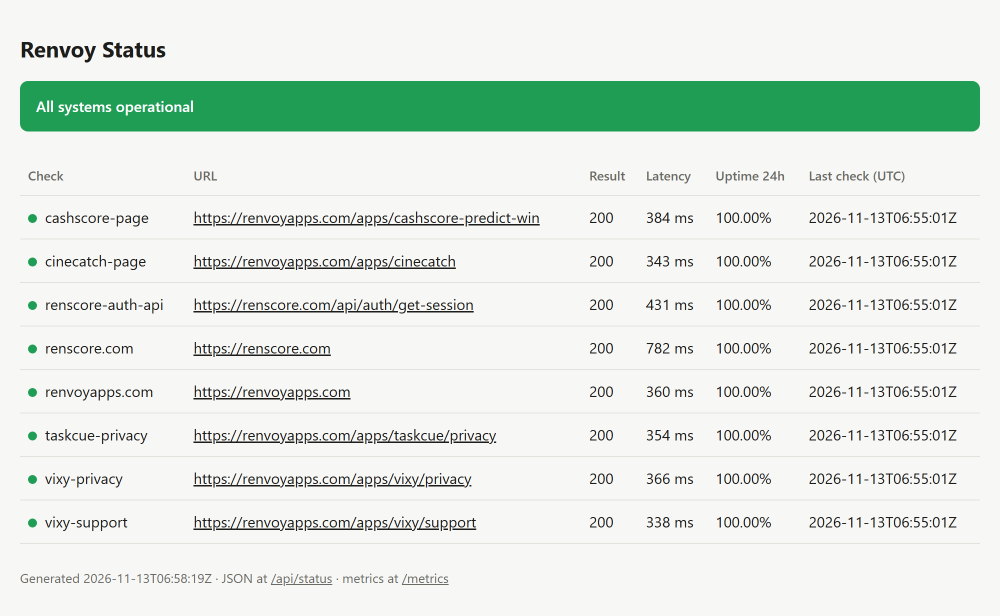
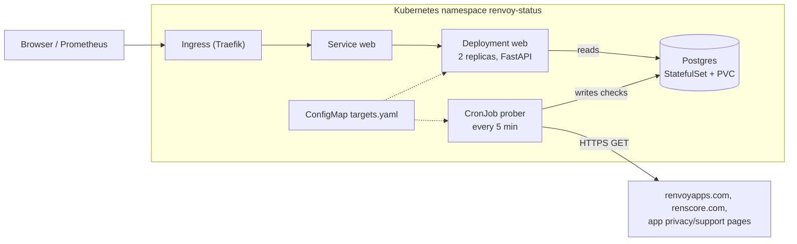

# renvoy-platform

[](https://github.com/LyViolz/renvoy-platform/actions/workflows/ci.yml?query=branch%3Amain)

Infrastructure for the **Renvoy status service**: a small Python service that probes the
public endpoints of [Renvoy](https://renvoyapps.com) apps every five minutes, stores the
history in Postgres and serves a status page, a JSON API and Prometheus metrics. It runs on
Kubernetes and is deployed, tested and torn down on an ephemeral cluster on every push.

Why it exists: Renvoy ships several mobile apps and the [Renscore](https://renscore.com) web
product. App Store and Google Play reviewers reject builds when the privacy or support URL
of an app is unreachable, so those pages are monitored next to the product surfaces.

**Scope, stated honestly:** the platform runs on a local [k3d](https://k3d.io) cluster and in
CI. There is no paid cloud deployment by design; every component is chosen so it could move
to a managed cluster without changes to the app.

<picture>
  <source media="(prefers-color-scheme: dark)" srcset="docs/status-page-dark.png">
  
</picture>

## Architecture



| Path | What it is |
| --- | --- |
| `app/` | FastAPI service and prober (`renvoy_status`), tests, Dockerfile |
| `deploy/k8s/base/` | Namespace, Postgres, web Deployment + Service, prober CronJob, targets ConfigMap |
| `deploy/k8s/overlays/local/` | Image tag, throwaway DB secret and Ingress for k3d and CI |
| `scripts/smoke.sh` | End-to-end check used by CI and locally |
| `.github/workflows/ci.yml` | Lint, tests on SQLite and Postgres, k3d end-to-end, image publish |

Endpoints: `/` status page, `/api/status` JSON, `/metrics` Prometheus, `/healthz` liveness,
`/readyz` readiness (checks the database).

## CI/CD

Every push and pull request runs these stages:

1. **test**: `ruff` lint and format check, then the test suite twice, against SQLite and
   against a real Postgres service container.
2. **build** (in parallel with test): builds the image once and stores it as a workflow
   artifact. Later stages use this artifact and never rebuild it.
3. **e2e**: creates a throwaway k3d cluster on the runner, imports the built image,
   applies the `local` overlay, triggers the prober CronJob as a one-off Job and runs
   `scripts/smoke.sh` (rollouts healthy, checks stored, API, metrics and page served).
   The cluster is deleted afterwards; on failure the job prints pods, events and logs.
4. **publish** (main only): pushes the same image that passed e2e to GHCR, tagged with the
   commit SHA and `latest`. Each stage logs the image ID, so the logs show it is one image.

## Run it locally

Requirements: Docker, [k3d](https://k3d.io), `kubectl`, [uv](https://docs.astral.sh/uv/).

```bash
make up      # create cluster, build + import image, deploy, smoke test
# open http://status.localhost:8080
make down    # delete the cluster
```

App only, without Kubernetes:

```bash
cd app
TARGETS_FILE=../deploy/k8s/base/targets.yaml uv run python -m renvoy_status.prober
TARGETS_FILE=../deploy/k8s/base/targets.yaml uv run uvicorn renvoy_status.web:app --reload
```

## Design decisions

- **Prober as a CronJob, not a loop inside the web process.** Web replicas scale without
  duplicating probes, a stuck probe is killed by `activeDeadlineSeconds`, and
  `concurrencyPolicy: Forbid` prevents overlapping rounds. A failing target is data, not a
  failed Job; the Job fails only when it cannot probe or write.
- **Readiness checks the database, liveness does not.** A Postgres outage takes pods out of
  the Service instead of restart-looping them.
- **Fail fast when the database is gone.** An outage drill (Postgres scaled to zero) showed
  requests hanging for 39 s and then returning 500, because there was no connect timeout. Now
  connections give up after 3 s, the page and API answer 503 with `Retry-After`, and
  `/readyz` returns its own 503 within the probe timeout.
- **Hardened pods.** Non-root UID, read-only root filesystem, all capabilities dropped,
  `RuntimeDefault` seccomp; the namespace enforces the `baseline` Pod Security Standard and
  warns on `restricted`.
- **Targets are configuration.** They live in one file, shipped as a ConfigMap and
  validated by a unit test so a typo fails CI, not production.
- **Secrets.** The only credential in the repo is a throwaway password for disposable
  local/CI clusters. A real environment would use External Secrets or Sealed Secrets.

## Roadmap

- [x] **Phase 1: service and delivery.** App with tests, container image, Kubernetes
  manifests with Kustomize, CI with an ephemeral-cluster end-to-end test, GHCR publish.
- [ ] **Phase 2: infrastructure as code and GitOps.** Terraform (Helm provider) installs
  cluster add-ons; Argo CD syncs `deploy/k8s` from this repo.
- [ ] **Phase 3: observability and alerting.** kube-prometheus-stack, a Grafana dashboard for
  the status metrics, alert rules (target down, stale checks) routed to Telegram.
- [ ] **Phase 4: data safety.** CloudNativePG with scheduled backups to S3-compatible storage
  (MinIO locally) and a scripted, CI-tested restore drill.

## License

[MIT](LICENSE)
